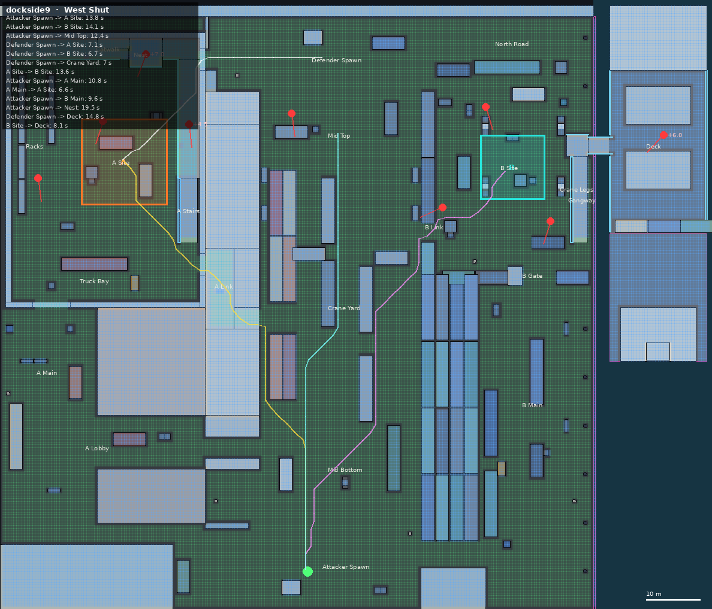
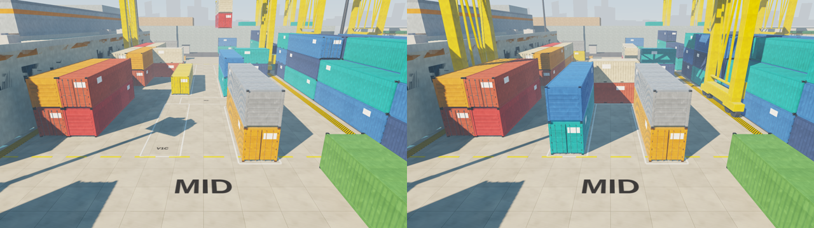
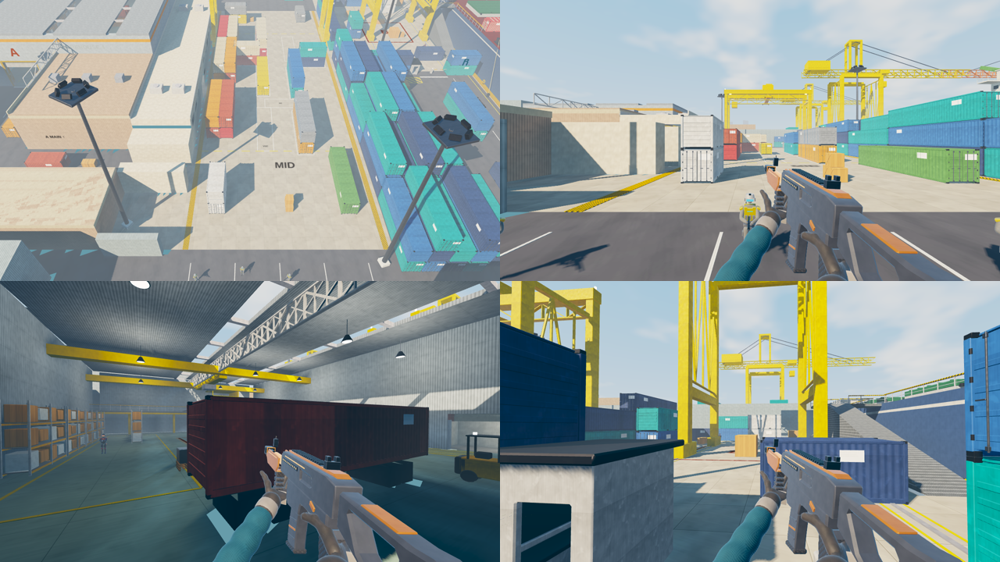

# Dockside 9 — map design

Heavy industrial port and cargo yard. Flagship map of the remake: three lanes, two sites with real
verticality, and a yard crane that physically re-stacks mid between rounds.

Source: `src/data/maps/dockside9.js` (brush map, BrushKit). Art: `art/docks.py`, `art/ship.py`,
`art/world_textures.py`. Checker: `node tools/mapcheck.mjs dockside9 shots/map` then
`python3 tools/mapviz.py shots/map.json out.png <layout>`.

## Layout

North is -Z, east is +X, quay level y = 0, harbour water y = -2.5. Playable 110 x 110 m plus the
freighter deck.

| Area | Where | What it is |
|---|---|---|
| Attacker Spawn | south, z 35..50 | Three exits: lobby corridor west, Mid Bottom north, B Main mouth east |
| A Lobby / A Main | west, x -68..-50 | 18 m truck lane, offset container cover, ends at the 7 m roll-up door of Warehouse 4 |
| A Link | office block x -30..-20 | Dog-leg corridor (indoor, lit) from the yard to the warehouse's east door, beside the stairs |
| Warehouse 4 (A) | x -67..-30, z -57..-6 | Racks aisle, truck bay, site A; +4.5 m catwalk (north + east); +7 m crane nest; skylights |
| Mid / Crane Yard | x -20..10 | RTG container block: fixed west rows, three 4.7 m lanes, crane rail lanes, 9 crane slots |
| B Link | z -21.6..-18 | 3.6 m gap through the B-side container wall onto the pier, crate dog-leg on the far side |
| B Main | x 22..41 | Quay road with two lanes (back-road container row), gate with booth + boom gate |
| Pier 9 (B) | x 10..41, z -50..-12 | Open apron, quay-crane legs as the signature cover, reefer pair, crates |
| Gangway / Deck | east edge | Stair tower to a bridge onto the freighter deck (+6 m): hatch covers, deck containers |
| Defender Spawn / North Road | north | Back door into the warehouse, south into Mid Top, east along the north road to the pier |

Colour code: A-side cover is warm (orange, red, rust, cream), B-side cool (teal, blue, navy), mid
neutral with yellow crane hardware. Big painted A / B letters face every approach.

## Rotation timings (run speed 6.75 m/s, shortest walkable path, from `mapcheck`)

| Route | Time |
|---|---|
| Attacker Spawn -> A Site (via A Link) | 13.8–14.3 s |
| Attacker Spawn -> A Main -> A Site | 10.8 + 6.6 s |
| Attacker Spawn -> B Site | 14.1 s |
| Attacker Spawn -> Mid Top | 12.4 s |
| Defender Spawn -> A Site / B Site | 7.1 s / 6.7 s |
| A Site <-> B Site | 13.6 s |
| B Site -> Deck | 8.1 s |
| Defender Spawn -> Deck | 14.8 s |

Every callout, spawn and hostile post is reachable in all three crane layouts (the checker fails
otherwise; `test/sim.test.mjs` covers collision switching and the B plant).

## The crane (gimmick)

Six physical stacks (A–E, W) live in nine painted slots (V1A..V2C column slots, XW / XC / XE cross
slots that close a lane). Each layout assigns every stack a slot; collision exists per stack@slot.
The authority picks the next layout at round start (never the same twice) and replicates it; the
barrier phase is 7 s. During it the RTG crane carries exactly the stacks whose slot changed
(lift, travel, lower), then parks where that layout's leg collision is.

| Layout | Effect |
|---|---|
| West Shut | lane W blocked by the cross stack; centre lane runs end to end |
| Zig-Zag | west lane open; centre and east broken by cross stacks |
| Open Middle | north end sealed by column stacks; crossings in the middle |

## Defender posts (bots)

Nest (+7, covers the roll-up door and site) · east catwalk (+4.5, A Link door) · site A behind the
orange pair · rack aisle · Mid Top behind the yellow stack · B Link crate pile · freighter deck
between the hatch covers (+6) · site B behind a crane bogie · B behind the navy 20'.

## Art kit

- Brushes: architecture, ground slabs, markings (2 cm paint brushes), skyline (render-only).
- `docks.glb`: 40'/20' containers, RTG crane (frame / trolley / spreader / cable), quay crane,
  bollards, fenders, light masts, jersey barriers, crates, pallets, barrels, forklift, booth,
  boom gate, roof trusses, racks, highbay lamps, gangway, lifebuoys.
- `ship.glb`: superstructure, hatch covers, deck crane, lifeboat, bitts, mooring lines.
- Stylized world textures: quay slabs, asphalt, epoxy floor, corrugated cladding, painted steel,
  hazard, deck, shutter, glazing, plaster, grating, concrete, water.
- Lighting: late-afternoon sun from the south-west, static sun shadow map for the whole level,
  baked sky + bounce + 11 lamps (warehouse highbays, office corridor).

